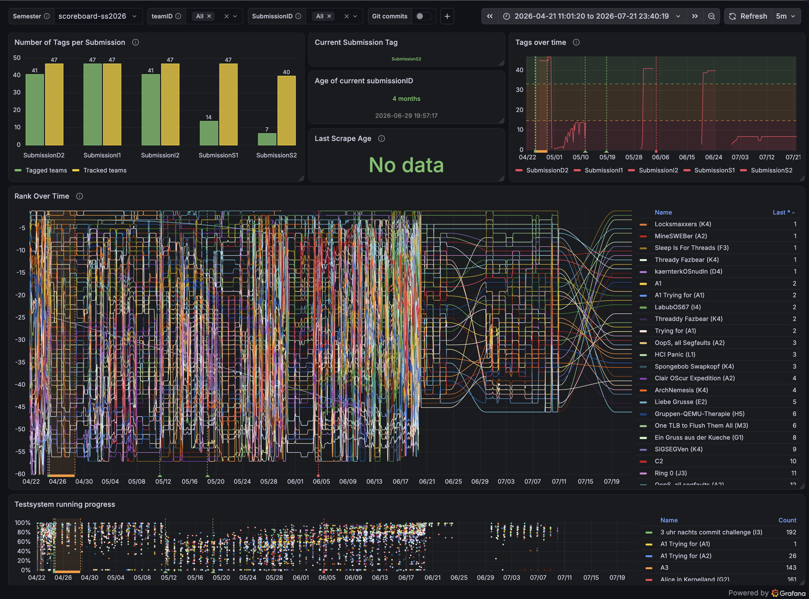

# TU Graz OS-scoreboard-monitor

Scrapes the public [TU Graz Tacos/Sweb OS scoreboard](https://sweb.student.isec.tugraz.at/), normalizes the standings, stores time-series snapshots in InfluxDB 2 OSS, and exposes the data to Grafana.

This project is deployed on my vps and in use since SS 2026.

**Check out the latest snapshot of [last summer semester (SS2026)](https://os-scoreboard.sest-it.at/dashboard/snapshot/d2Di7urjgQqpS570xMd7oJ6HJgQwWckU?from=2026-04-21T09:01:20.291Z&to=2026-07-21T21:40:19.661Z&timezone=browser&var-bucket=scoreboard-ss2026&var-team_id=$__all&var-submission_type=$__all&refresh=5m):**

---
### Public source-available repository
Use, copying, modification, or redistribution requires prior written permission.
